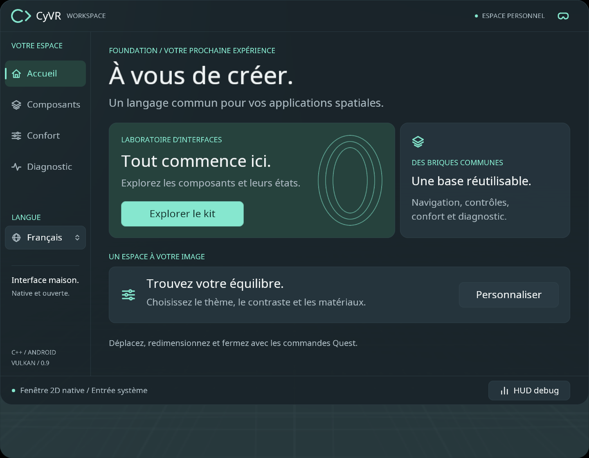
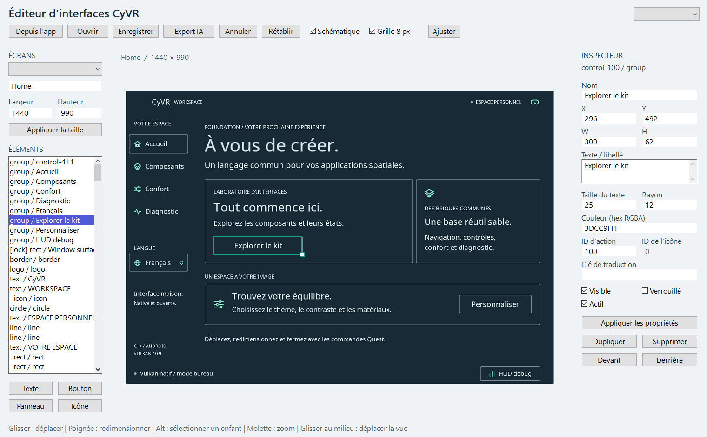

<table width="100%">
  <tr>
    <td width="300" align="left" valign="top">
      <a href="docs/REFERENCE_GUIDE.md">Guide de l’application (EN)</a><br>
      <a href="docs/INTERFACE_EDITOR.md">Guide de l’éditeur PC (EN)</a><br>
      <a href="https://github.com/MrMybal/CyVR_UI">Dépôt</a><br><br>
      <sub>README</sub><br>
      <a href="README.md">English</a> · <a href="README.fr.md">Français</a>
    </td>
    <td width="400" align="center" valign="middle">
      <strong>2D · VR · AR</strong><br>
      <sub>Interfaces natives pour Meta Quest</sub><br>
      <sub>C++17 · Vulkan · OpenXR</sub>
    </td>
    <td width="300" align="right" valign="top">
      <p><sub>Licence de l’application</sub><br><a href="LICENSE"><strong>MIT</strong></a></p>
      <p><sub>Versions</sub><br><a href="VERSION.fr.md"><strong>Sources 0.9.1</strong><br><strong>APK 0.8.0-test.1</strong></a><br><strong>EN DÉVELOPPEMENT</strong></p>
      <p><a href="https://github.com/MrMybal/CyVR_UI/releases/download/v0.8.0-test.1/CyVR_UI-0.8.0-test.1-arm64.apk"><strong>Télécharger l’APK de test Quest</strong></a><br><sub>Android ARM64 · 0.8.0-test.1</sub></p>
    </td>
  </tr>
</table>

<h1 align="center">CyVR UI</h1>

Un socle d’interfaces natif et open source pour les développeurs d’**applications Meta Quest**. Partagez les contrôles 2D, les thèmes et les traductions entre une fenêtre Android classique et un mode VR/AR immersif optionnel. Le projet comprend des bibliothèques **C++17 / Vulkan** réutilisables, une application de référence Quest et un éditeur d’interfaces Windows natif. OpenXR est utilisé par l’hôte immersif.

> **EN DÉVELOPPEMENT · Sources 0.9.1 · APK de test publié 0.8.0-test.1**
>
> Ces versions sont expérimentales et signées pour le développement. L’éditeur PC et les nouvelles commandes de fenêtre sont disponibles dans les sources ; ils sont plus récents que l’APK téléchargeable. Consultez les [notes de version et limites connues](VERSION.fr.md).

[](docs/images/catalogue-2d-fr.png)

## À propos de CyVR UI

L’application de référence s’ouvre dans une **fenêtre 2D native** gérée par Horizon OS. Les applications classiques peuvent partager l’espace de travail Quest, et une même application peut proposer un mode immersif explicite lorsqu’elle a besoin d’un environnement 3D complet. Les deux hôtes réutilisent les contrôles, la capture des pointeurs, les préférences, les thèmes et la localisation. Une compilation strictement 2D exclut OpenXR et les ressources des environnements immersifs.

Explorez les boutons, interrupteurs, curseurs, contrôles segmentés et boîtes de dialogue du catalogue. Réglez l’apparence, passez de l’anglais au français ou ouvrez le HUD de diagnostic. En immersion, utilisez la barre fixe et ses icônes latérales pour gérer la fenêtre, saisissez sa surface pour la déplacer ou prenez un bord autorisé pour la redimensionner. Le joystick règle la distance et la rotation pendant la prise. Voir le [guide des interactions de fenêtre (en anglais)](docs/WINDOW_INTERACTIONS.md).

L’**éditeur d’interfaces PC** capture les véritables écrans 2D de l’application de référence. Sélectionnez, déplacez, redimensionnez et stylisez les éléments en vue fidèle ou schématique, puis enregistrez une disposition JSON versionnée. **Export IA** produit le JSON, un plan des éléments et des PNG des écrans pour discuter des modifications avec un assistant ; l’export reste local. Les applications peuvent afficher les documents modifiés avec la bibliothèque optionnelle `cyvr_layout`. Le chargement d’un document dans la référence Quest nécessite une intégration ; l’éditeur ne met pas automatiquement l’APK à jour.

[](docs/images/editor-fr.png)

Ces images sont des captures Windows natives avec du contenu de démonstration. Elles illustrent la version actuelle des sources, et non la vue des caméras du casque ou une capture de l’ancien APK publié.

## Fonctionnalités

- **Interface native partagée** : contrôles réutilisables, capture des pointeurs, dialogues modaux, notifications et points d’extension pour le rendu et les entrées applicatives.
- **Priorité à la 2D** : fenêtres Quest gérées par le système ; VR/AR immersive optionnelle avec ancrage dans le monde, orientation vers l’utilisateur et suivi du point de vue.
- **Commandes de fenêtre immersives** : barre fixe avec icônes latérales au survol, prise sur toute la surface avec manette ou main, redimensionnement configurable par les bords et réglage de distance/rotation au joystick. Les applications compactes peuvent exposer leur propre poignée de déplacement à la gâchette.
- **Apparence** : thèmes Graphite, Clair et Océan, opacité des surfaces et verre dépoli sur les environnements virtuels.
- **Environnements** : trois scènes originales modélisées, avec matériaux PBR et éclairage précalculé, deux panoramas photographiques CC0 et vue réelle du casque optionnelle.
- **Mains et diagnostic** : maillages suivis lorsque disponibles, gant pour manettes, modes squelette ou mains masquées, lasers, HUD et export local du diagnostic.
- **Langues et création** : anglais par défaut, français inclus, catalogues UTF-8 et éditeur Windows 2D avec export JSON/Markdown/PNG.

---

## Installation

### Application de test Quest

Le manifeste cible les **Quest 2, Quest 3S, Quest 3 et Quest Pro**. Le Quest 3 a été utilisé pour les essais ; la couverture des appareils et plusieurs fonctions restent à valider. Les transitions hybrides 2D/immersif nécessitent **Horizon OS v69 ou ultérieur**. Consultez les [notes de version](VERSION.fr.md).

1. [Téléchargez l’APK ARM64 0.8.0-test.1](https://github.com/MrMybal/CyVR_UI/releases/download/v0.8.0-test.1/CyVR_UI-0.8.0-test.1-arm64.apk).
2. Activez le mode développeur et le débogage USB du Quest, autorisez l’ordinateur connecté, puis installez avec Android Platform Tools :

   ```powershell
   adb install -r CyVR_UI-0.8.0-test.1-arm64.apk
   ```

3. Ouvrez **CyVR UI** dans **Sources inconnues**. L’application démarre en fenêtre 2D. L’icône de casque active l’immersion ; l’icône des fenêtres superposées permet de revenir en 2D.

Pour une utilisation exclusivement 2D, choisissez l’[APK strictement 2D](https://github.com/MrMybal/CyVR_UI/releases/download/v0.8.0-test.1/CyVR_UI-0.8.0-test.1-panel-arm64.apk). Les deux APK sont des variantes du même paquet `com.cyvr.ui` ; installez-en une seule à la fois. Les [notes de publication](https://github.com/MrMybal/CyVR_UI/releases/tag/v0.8.0-test.1) et les [empreintes SHA-256](https://github.com/MrMybal/CyVR_UI/releases/download/v0.8.0-test.1/SHA256SUMS.txt) accompagnent les téléchargements. Une distribution de production nécessite sa propre configuration de signature.

### Éditeur et inspecteur Windows

L’éditeur et l’inspecteur sont actuellement à **compiler depuis les sources** sous Windows x64, avec un pilote Vulkan. Après compilation, lancez `dist/windows/CyVR_Editor.exe` ou `dist/windows/CyVR_UI.exe`. Conservez leur dossier `assets` à côté des exécutables. Le [guide de l’éditeur (en anglais)](docs/INTERFACE_EDITOR.md) décrit l’édition et les exports.

## Sources, compilation et bibliothèques nécessaires

<details>
<summary>Compiler l’application de référence, les outils Windows ou une application réutilisant le socle</summary>

Les scripts fournis fonctionnent sous Windows. Installez **Python 3**, **LLVM/Clang 19+** avec le **SDK C++ Windows**, un **SDK Android** et un **JDK**. La compilation détecte d’abord le Clang fourni avec Visual Studio, puis une installation LLVM autonome. Les versions Android utilisent le compilateur du NDK.

| Composant Android | Version fixée |
| --- | --- |
| NDK | 27.2.12479018 |
| CMake / générateur | 3.22.1 / Ninja |
| Build Tools | 35.0.1 |
| SDK de compilation / cible | 34 |
| SDK minimal | 32 |

Définissez `ANDROID_HOME` et `JAVA_HOME` si vos installations diffèrent des emplacements par défaut du script.

```powershell
git clone https://github.com/MrMybal/CyVR_UI.git
cd CyVR_UI
.\build.ps1 -Target windows             # Éditeur, inspecteur et tests C++
.\build.ps1 -Target android             # APK 2D natif + immersion optionnelle
.\build.ps1 -Target android -NoImmersive # APK strictement 2D
.\build.ps1 -Target tests               # Compiler et exécuter les tests natifs
```

La version hybride télécharge et vérifie le **chargeur Khronos OpenXR 1.1.49** fixé par le projet. La version Android strictement 2D ne le télécharge ni ne l’embarque. Les polices, shaders et ressources préparées des modèles et environnements sont inclus. Le paquet est construit avec le NDK, javac, d8, aapt2, zipalign et apksigner ; aucun greffon Gradle, moteur de jeu ou SDK Meta propriétaire n’est intégré.

Les résultats sont `dist/android/CyVR_UI-debug.apk`, `dist/android/CyVR_UI-panel-debug.apk` et `dist/windows/`. Pour installer l’APK hybride compilé sur un seul casque connecté et autorisé :

```powershell
.\tools\install-quest.ps1
```

Pour l’intégration, `cyvr_ui` fournit les contrôles, la géométrie et la localisation ; `cyvr_gpu`, le rendu Vulkan ; `cyvr_android`, les hôtes Android. La bibliothèque optionnelle `cyvr_layout` charge et dessine les documents éditables. Les guides d’[intégration Android](docs/ANDROID_HOSTS.md), d’[architecture](docs/ARCHITECTURE.md) et de [référence](docs/REFERENCE_GUIDE.md) détaillent les variantes, commandes, rendu, traductions et outils optionnels de génération des ressources. Ces guides techniques sont en anglais ou en français selon le fichier.

</details>

---

## Licence

Le code CyVR original, les icônes des contrôles, les environnements modélisés, les ressources PBR et la géométrie du gant utilisent la **[licence MIT](LICENSE)**. Copyright © 2026 CyVR contributors. Conservez sa notice lors de la réutilisation ou redistribution. Les logos restent exclus de cette licence et ne sont inclus ni dans le dépôt ni dans les archives de distribution.

### Bibliothèques et ressources tierces

| Bibliothèque · sources | Licence · texte | Utilisation / périmètre |
| --- | --- | --- |
| [Khronos OpenXR SDK 1.1.49](https://github.com/KhronosGroup/OpenXR-SDK/tree/release-1.1.49) | [Apache-2.0](third_party/openxr/LICENSE) ; certains en-têtes proposent aussi MIT | Hôte Android immersif uniquement : en-têtes et chargeur du runtime système. |
| [JsonCpp](https://github.com/KhronosGroup/OpenXR-SDK/tree/release-1.1.49/src/external/jsoncpp) | [MIT / conditions de domaine public](third_party/notices/jsoncpp-LICENSE.txt) | Lecture des manifestes du runtime, incluse dans le chargeur OpenXR optionnel. |
| [jnipp](https://github.com/KhronosGroup/OpenXR-SDK/tree/release-1.1.49/src/external/jnipp) | [MIT](third_party/notices/jnipp-LICENSE.txt) | Utilitaire JNI inclus dans le chargeur OpenXR optionnel. |
| [android-jni-wrappers](https://github.com/KhronosGroup/OpenXR-SDK/tree/release-1.1.49/src/external/android-jni-wrappers) | [BSL-1.0](third_party/notices/BSL-1.0.txt) | Interfaces JNI générées incluses dans le chargeur OpenXR optionnel. |
| [Vulkan Headers v1.3.290](https://github.com/KhronosGroup/Vulkan-Headers/tree/v1.3.290) | [Apache-2.0 / MIT selon le fichier](third_party/vulkan/LICENSE.md) ; option Apache retenue ici | Déclarations de l’API graphique ; pilote Vulkan fourni par le système. |
| [Noto Sans Regular](https://github.com/notofonts/noto-fonts/tree/v20201206-phase3) | [SIL OFL 1.1](assets/fonts/OFL.txt) | Police intégrée et atlas de texte dérivé. |
| [stb_image](https://github.com/nothings/stb/tree/013ac3beddff3dbffafd5177e7972067cd2b5083) | [MIT ou domaine public](third_party/stb/LICENSE) ; option MIT retenue ici | Décodage JPEG des environnements photographiques optionnels. |
| [Android native_app_glue](https://developer.android.com/ndk) | [Apache-2.0 et notices NDK](third_party/notices/Android-NDK-NOTICE.txt) | Cycle de vie NativeActivity des versions Android. |
| [LLVM libc++ / runtime du compilateur Android](https://github.com/llvm/llvm-project) | [Apache-2.0 WITH LLVM-exception et notices des composants](third_party/notices/Android-NDK-Toolchain-NOTICE.txt) | Bibliothèque standard C++ et support du compilateur Android. |
| [Panoramas Poly Haven · Greg Zaal](assets/scenes/README.md) | [CC0-1.0](third_party/notices/CC0-1.0.txt) | Décors photographiques 4K intégrés, optionnels. |
| [Pillow](https://github.com/python-pillow/Pillow) | [MIT-CMU](https://github.com/python-pillow/Pillow/blob/main/LICENSE) | Outils optionnels de génération de police/panoramas ; absent du runtime de l’application. |
| [NumPy](https://github.com/numpy/numpy) | [BSD-3-Clause et notices des composants inclus](https://github.com/numpy/numpy/blob/main/LICENSE.txt) | Outils optionnels de génération du gant et des ressources PBR ; absent du runtime de l’application. |

Ce tableau répertorie les principaux composants. Conservez les [notices tierces complètes](THIRD_PARTY.md) et les textes livrés dans `licenses/`. Les outils de compilation gardent leurs propres conditions. Le système Quest, le runtime OpenXR et les pilotes graphiques sont fournis par la plateforme.

## Références et liens

- [Guide de l’application et des développeurs (EN)](docs/REFERENCE_GUIDE.md) · [Éditeur PC (EN)](docs/INTERFACE_EDITOR.md) · [Commandes de fenêtre (EN)](docs/WINDOW_INTERACTIONS.md).
- [Hôtes Android et intégration (EN)](docs/ANDROID_HOSTS.md) · [Architecture](docs/ARCHITECTURE.md) · [Localisation](docs/LOCALIZATION.md).
- [Notes de version et limites](VERSION.fr.md) · [Dépôt des sources](https://github.com/MrMybal/CyVR_UI) · [Versions publiées](https://github.com/MrMybal/CyVR_UI/releases) · [Suivi des problèmes](https://github.com/MrMybal/CyVR_UI/issues).
