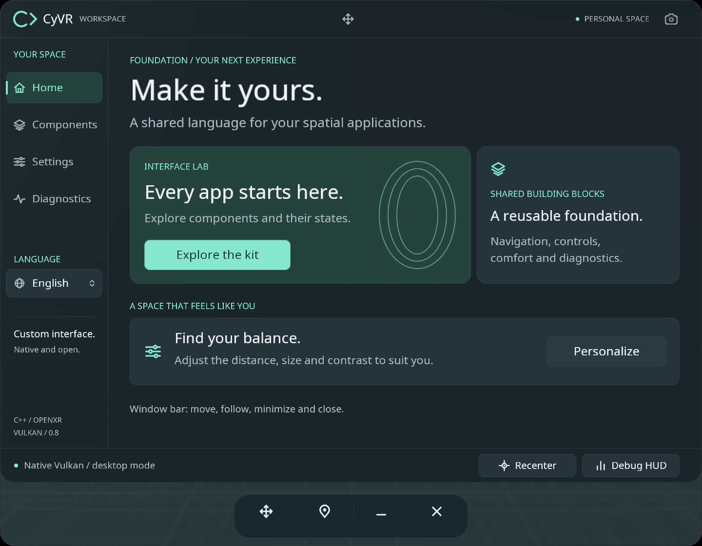

# CyVR UI

A native, open-source **2D interface foundation** for applications on **Meta Quest 2, Quest 3S, Quest 3 and Quest Pro**, with an optional immersive host. Built with **C++17 and Vulkan**, plus **OpenXR only for immersion**, with a custom UI renderer and no game engine or web runtime.

Version **0.4.0** starts in a resizable native Android 2D window managed by Horizon OS. This lets ordinary apps share the Quest workspace. Apps that need a full 3D experience can opt into the immersive activity; both hosts reuse the same UI components, themes, translations and preferences. A 2D-only build excludes OpenXR entirely. Hybrid transitions require Horizon OS v69 or later.

The project includes reusable C++ libraries, a standalone Quest reference app and a Windows inspector. The previous immersive implementation has been exercised on Quest 3; see [Validation](docs/VALIDATION.md) for the status of the new 2D host and other devices.



The image shows the shared catalogue in the Windows inspector. Native 2D mode uses the Quest system window controls instead of the floating immersive bar.

## Features

- A component catalogue: buttons, toggles, sliders with pointer capture, segmented controls, badges, toasts and modal dialogs.
- Native 2D windows with system pointer/touch input and Quest window management; no OpenXR session in the panel host.
- Optional immersive mode, selected explicitly through a headset icon; its overlapping-window icon returns to 2D.
- In immersive mode, a floating icon bar for moving, minimizing, closing, restoring and changing window placement. Action names appear on hover.
- In immersive mode, world anchoring, viewer-facing orientation and smooth view following. Following pauses during interaction.
- Graphite, Light and Ocean themes; surface opacity; frosted glass over the native environment; Studio and Night backgrounds.
- Optional immersive headset passthrough. Its camera image is not exposed to the application or blurred by the UI renderer.
- In immersive mode, smooth tracked-hand meshes when available; an original Studio glove for controllers; skeleton and hidden-hand modes; optional laser pointers.
- An independent diagnostics HUD, local preferences and JSON export.
- English by default, French included, and UTF-8 translation catalogues separated from rendering code.

## Build and run

The supplied scripts run on Windows. Install Python 3, LLVM/Clang 19 or newer with the Windows C++ SDK, an Android SDK, and a JDK. The build uses these pinned Android components:

| Component | Version |
|---|---|
| Android NDK | 27.2.12479018 |
| CMake | 3.22.1, with Ninja |
| Android Build Tools | 35.0.1 |
| Compile / target SDK | 34 |
| Minimum Android SDK | 32 |

Set `ANDROID_HOME` and `JAVA_HOME` when using installations outside the default locations. The Windows build detects the Clang bundled with Visual Studio before the standalone LLVM installation. Quest builds use the NDK compiler.

```powershell
.\build.ps1                 # Windows inspector, C++ tests and Quest APK
.\build.ps1 -Target windows # Windows inspector and tests
.\build.ps1 -Target android # ARM64 Quest APK: 2D by default, optional immersion
.\build.ps1 -Target android -NoImmersive # Native 2D APK, no OpenXR library
.\build.ps1 -Target tests   # Portable core tests
```

The first build downloads the official Khronos OpenXR loader AAR and verifies its pinned SHA-256. Headers, fonts, generated translation data and model assets are included in the repository. No proprietary Meta SDK is embedded. APK packaging uses CMake/NDK, javac, d8, aapt2, zipalign and apksigner; Gradle is not required. A small Java NativeActivity bridge handles activity transitions; the UI and rendering remain C++. The 2D-only build does not download or package the OpenXR loader.

- **Quest:** install `dist/android/CyVR_UI-debug.apk`, then open **CyVR UI** under **Unknown Sources**. It opens in a **2D window**. The 2D-only APK is `dist/android/CyVR_UI-panel-debug.apk` (same package, alternative build).
- **Windows:** run `dist/windows/CyVR_UI.exe` with its `assets` folder alongside it. A Vulkan graphics driver is required.

For a connected development headset:

```powershell
.\tools\install-quest.ps1
# With multiple devices connected:
.\tools\install-quest.ps1 -Serial DEVICE_SERIAL
```

The APK uses a local development signing key. A production distribution needs its own signing and release configuration. Build output is kept in `build/` and `dist/`; generated application packages are not committed to the source repository.

## Controls

**Native 2D:** use the Quest system pointer, hand pinch or touch to activate controls. Drag sliders through the same shared input-capture code. Move, resize, minimize and close the window with Horizon OS controls. Settings show appearance and accessibility controls; hand meshes, 3D distance and world anchoring belong to the immersive host.

**Optional immersion:** select the headset icon in the header. The app closes its 2D activity and starts OpenXR. Select the overlapping-window icon to return to the Home workspace as a 2D panel. The current page and saved appearance/language preferences carry across. Entering immersion takes the active immersive slot; ordinary 2D windows remain managed by Horizon OS.

| Immersive action | Controllers | Tracked hands |
|---|---|---|
| Point | Aim a controller; the pointer and reticle indicate the target | Aim the hand pointer |
| Select | Press and release the trigger | Pinch and release thumb and index |
| Move a window | Hold the four-arrow handle in the floating bar or title area | Hold the same handle with a pinch |
| Minimize / restore | Use the minus / overlapping-window icon | Select the same icon |
| Close / reopen | Use the cross / CyVR grid icon | Select the same icon |
| Placement mode | Cycle the pin, eye and headset icon, or use Settings | Select the same controls |
| Recenter | UI button or right stick click | UI button |
| Diagnostics HUD | UI button or left X button | UI button |

The floating bar remains available while the content is minimized or closed. Minimizing preserves the page; closing returns to Home when reopened. Moving a followed window switches it back to a world anchor. On release, the window faces the viewer without copying head roll. Reduced motion slows automatic following.

The Windows inspector uses the mouse. The move handle drags the native window; keys **1–4** select pages, **D** toggles the HUD, **R** recenters the preview, and **Escape** dismisses a modal.

## Languages

The sidebar language button cycles through the available catalogues. A new installation uses **English**; the selected language is saved locally. Existing preferences without a language field also default to English. Resetting comfort settings keeps the current language.

- Source messages: [`assets/locales/en.json`](assets/locales/en.json).
- French translation: [`assets/locales/fr.json`](assets/locales/fr.json).
- Runtime API: [`include/cyvr/locale.hpp`](include/cyvr/locale.hpp).
- Generated table: `include/cyvr/locale_data.hpp`.

Use stable keys such as `nav.home` with `UiModel::tr()` or `cyvr::translate()`. `formatMessage()` accepts named placeholders, and `formatNumber()` formats numbers for the selected locale. Unsupported locales fall back to English; regional locales first resolve to their base language. Missing translated messages fall back to the English source message.

To add a language, copy the English JSON catalogue to `<language-code>.json`, set `_name` to its native name and translate its values without changing keys or placeholder names. Then run:

```powershell
python tools/generate_locales.py
python tools/generate_locales.py --check
```

The build script regenerates the table automatically; the language selector discovers all compiled catalogues. The runtime needs no JSON parser or localization dependency. The generator checks message keys, named placeholders and font coverage. The current atlas covers Western European Latin text. Other writing systems require an appropriate font atlas; right-to-left layout and complex text shaping are not implemented.

## Reuse the foundation

`cyvr_ui` provides drawing primitives, geometry, input capture, settings, translations and statistics. `cyvr_gpu` provides the Vulkan renderer. The reference pages live in `src/ui.cpp`; interaction logic is in `src/core.cpp`.

Applications can replace the reference pages with `UiModel::renderApplication` and `handleApplicationAction`, and register controls through `applicationWidget()`. On Android, `AndroidAppConfig` and `runAndroidApp()` allow an application to configure its own name and UI while reusing the native 2D host by default. Link `cyvr_android`; set `AndroidAppConfig::immersiveEnabled` only for apps that expose immersion, and build with `CYVR_ENABLE_IMMERSIVE=OFF` for strictly 2D apps. Keep business state above activity lifetimes. See [Android hosts and migration](docs/ANDROID_HOSTS.md) and [Architecture](docs/ARCHITECTURE.md).

Hand models can be supplied through `HandSurface` or `HandSkin`. The included controller glove is generated by `tools/bake_hands.py` and is covered by the project MIT license. Importing an alternative model currently requires changing the code or assets; the headset app does not contain a model-file picker.

## Rendering and diagnostics

The 2D host presents directly to an Android Vulkan swapchain, redraws on UI changes, fits the logical canvas to resized windows and maps system coordinates back into the shared input model. It stops GPU work while paused and does no CPU image readback. Idle UI does not submit repeated frames; UI timers are serviced at up to 30 Hz. Panel diagnostics leave display cadence unmeasured rather than treating idle redraw intervals as headset FPS.

The optional immersive host draws UI text and controls into cached OpenXR quad layers. Frosted glass samples the native procedural environment through a 480 × 330 intermediate target. The backdrop viewpoint is updated at up to 30 Hz while it moves, in addition to content updates. Text remains sharp. Hands and the environment use per-eye rendering with depth, capped at 1024 pixels on the longest side. The Quest path does not read images back to the CPU.

The HUD reports application cadence, P95 frame intervals, work time excluding `xrWaitFrame`, display refresh rate and RSS memory. **GPU time is not instrumented.** Work time includes explicit driver waits and is not a CPU-utilization metric. Requested 72/90/120 Hz modes are offered only when reported by the runtime; they are not performance guarantees.

Diagnostics are exported locally to `/sdcard/Android/data/com.cyvr.ui/files/diagnostic.json` on Quest and alongside the executable on Windows. A startup report is written after 240 visible frames. Screenshot mode uses fixed demonstration metrics. See [Validation](docs/VALIDATION.md).

## Current limits

The shared layout currently fits a 1440 × 990 logical canvas while preserving aspect ratio; it letterboxes rather than reflowing at narrow window sizes. In 2D, opacity and blur affect only the app-owned backdrop, not other apps or the system environment.

Immersive windows are flat. Depth testing applies within the 3D layer; UI layers are composed above the hands without cross-layer depth occlusion. Blur covers the native environment, not hands or passthrough. Free window rotation, two-hand resizing, curved panels, editable text fields, a virtual keyboard and eye tracking are not implemented.

## Asset tools

Generated assets are included, so these tools are optional:

```powershell
python -m pip install -r tools/requirements-font.txt
python tools/bake_font.py
python -m pip install -r tools/requirements-hands.txt
python tools/bake_hands.py
```

`python tools/package.py` creates local Windows and source archives after a build.

## License

Original CyVR code, UI control icons and glove geometry are licensed under [MIT](LICENSE). The application may be used in open-source and commercial projects under the applicable licenses. The logo artwork in `assets/branding/` is excluded from this MIT grant and is not included in the repository or distribution archives. Third-party components retain their own terms; see [THIRD_PARTY.md](THIRD_PARTY.md). The Quest operating system, system OpenXR runtime and graphics drivers are provided by the device platform.
