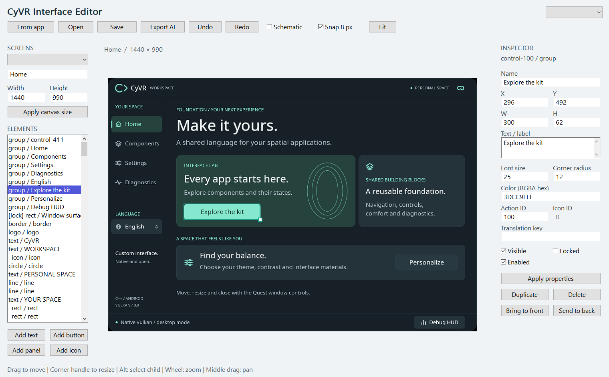

<table width="100%">
  <tr>
    <td width="300" align="left" valign="top">
      <a href="docs/REFERENCE_GUIDE.md">Application guide</a><br>
      <a href="docs/INTERFACE_EDITOR.md">PC editor guide</a><br>
      <a href="https://github.com/MrMybal/CyVR_UI">Repository</a><br><br>
      <sub>README</sub><br>
      <a href="README.md">English</a> · <a href="README.fr.md">Français</a>
    </td>
    <td width="400" align="center" valign="middle">
      <strong>2D · VR · AR</strong><br>
      <sub>Native interfaces for Meta Quest</sub><br>
      <sub>C++17 · Vulkan · OpenXR</sub>
    </td>
    <td width="300" align="right" valign="top">
      <p><sub>Application license</sub><br><a href="LICENSE"><strong>MIT</strong></a></p>
      <p><sub>Versions</sub><br><a href="VERSION.md"><strong>Source 0.9.1</strong><br><strong>APK 0.8.0-test.1</strong></a><br><strong>IN DEVELOPMENT</strong></p>
      <p><a href="https://github.com/MrMybal/CyVR_UI/releases/download/v0.8.0-test.1/CyVR_UI-0.8.0-test.1-arm64.apk"><strong>Download Quest test APK</strong></a><br><sub>Android ARM64 · 0.8.0-test.1</sub></p>
    </td>
  </tr>
</table>

<h1 align="center">CyVR UI</h1>

A native, open-source interface foundation for developers building **Meta Quest applications**. Share 2D controls, themes and translations between a regular Android window and optional immersive VR/AR. The project includes reusable **C++17 / Vulkan** libraries, a Quest reference application and a native Windows interface editor. OpenXR is used by the immersive host.

> **IN DEVELOPMENT · Source 0.9.1 · Published test APK 0.8.0-test.1**
>
> These are experimental, development-signed builds. The PC editor and newer window controls are available in source; they are newer than the downloadable APK. Read the [version notes and known limitations](VERSION.md).

[](docs/images/catalogue-2d.png)

## About CyVR UI

The reference app opens in a **native 2D window** managed by Horizon OS. Ordinary apps can share the Quest workspace, and the same application can offer an explicit immersive mode when it needs a full 3D environment. Both hosts reuse controls, input capture, preferences, themes and localization. A strictly 2D build excludes OpenXR and immersive environment assets.

Explore buttons, toggles, sliders, segmented controls and dialogs in the catalogue. Adjust appearance, switch between English and French, or open the diagnostics HUD. In immersion, use the fixed bar and its side icons to manage the window, grip the surface to move it, or grip an enabled edge to resize it. The thumbstick adjusts distance and rotation while holding. See the [window interaction guide](docs/WINDOW_INTERACTIONS.md).

The **PC interface editor** captures the reference app's actual 2D screens. Select, move, resize and style elements in faithful or schematic view, then save a versioned JSON layout. **Export AI** creates JSON, an element outline and screen PNGs for discussing edits with an assistant; the export stays local. Applications can render edited documents through the optional `cyvr_layout` library. Loading a design into the reference Quest app requires integration; the editor does not update an APK automatically.

[](docs/images/editor.png)

These are native Windows captures with demonstration content. They illustrate the current source version, rather than a headset camera view or a capture of the older released APK.

## Features

- **Shared native UI:** reusable controls, pointer capture, modal dialogs, toasts and application-owned rendering/input hooks.
- **2D first:** system-managed Quest windows; optional immersive VR/AR with world anchoring, viewer-facing placement and view following.
- **Immersive window controls:** a fixed bar with side icons on hover, full-surface controller/hand grabs, configurable edge resizing, and thumbstick distance/yaw. Compact applications can expose their own trigger drag handle.
- **Appearance:** Graphite, Light and Ocean themes, surface opacity and frosted glass over virtual environments.
- **Environments:** three original modeled scenes with PBR materials and offline lighting, two CC0 photographic panoramas, and optional headset passthrough.
- **Hands and diagnostics:** tracked meshes when supported, a controller glove, skeleton/hidden-hand modes, laser pointers, a HUD and local diagnostic export.
- **Languages and authoring:** English by default, French included, UTF-8 translation catalogues and a Windows 2D editor with JSON/Markdown/PNG export.

---

## Installation

### Quest test application

The manifest targets **Quest 2, Quest 3S, Quest 3 and Quest Pro**. Quest 3 has been exercised; device coverage and individual features still require validation. Hybrid 2D/immersive transitions require **Horizon OS v69 or later**. See the [version notes](VERSION.md).

1. [Download the 0.8.0-test.1 ARM64 APK](https://github.com/MrMybal/CyVR_UI/releases/download/v0.8.0-test.1/CyVR_UI-0.8.0-test.1-arm64.apk).
2. Enable developer mode and USB debugging on the Quest, authorize the connected computer, then install with Android Platform Tools:

   ```powershell
   adb install -r CyVR_UI-0.8.0-test.1-arm64.apk
   ```

3. Open **CyVR UI** under **Unknown Sources**. It starts as a 2D window. Select the headset icon to enter immersion; the overlapping-window icon returns to 2D.

For 2D-only use, choose the [strictly 2D APK](https://github.com/MrMybal/CyVR_UI/releases/download/v0.8.0-test.1/CyVR_UI-0.8.0-test.1-panel-arm64.apk). The two APKs are alternative builds of the same `com.cyvr.ui` package; install one at a time. [Release notes](https://github.com/MrMybal/CyVR_UI/releases/tag/v0.8.0-test.1) and [SHA-256 checksums](https://github.com/MrMybal/CyVR_UI/releases/download/v0.8.0-test.1/SHA256SUMS.txt) accompany the downloads. Production distribution needs its own signing configuration.

### Windows editor and inspector

The editor and inspector are currently built **from source** on Windows x64 with a Vulkan graphics driver. After a Windows build, run `dist/windows/CyVR_Editor.exe` or `dist/windows/CyVR_UI.exe`. Keep their `assets` folder alongside them. Follow the [editor guide](docs/INTERFACE_EDITOR.md) for editing and exports.

## Source, build and required libraries

<details>
<summary>Build the reference app, Windows tools or a reusable application</summary>

The supplied scripts run on Windows. Install **Python 3**, **LLVM/Clang 19+** with the **Windows C++ SDK**, an **Android SDK** and a **JDK**. The build detects the Clang bundled with Visual Studio before a standalone LLVM installation. Android builds use the NDK compiler.

| Android component | Pinned version |
| --- | --- |
| NDK | 27.2.12479018 |
| CMake / generator | 3.22.1 / Ninja |
| Build Tools | 35.0.1 |
| Compile / target SDK | 34 |
| Minimum SDK | 32 |

Set `ANDROID_HOME` and `JAVA_HOME` when using installations outside the script defaults.

```powershell
git clone https://github.com/MrMybal/CyVR_UI.git
cd CyVR_UI
.\build.ps1 -Target windows             # Editor, inspector and C++ tests
.\build.ps1 -Target android             # Native 2D + optional immersive APK
.\build.ps1 -Target android -NoImmersive # Strictly 2D APK
.\build.ps1 -Target tests               # Build and run the native test suite
```

The hybrid build downloads and verifies the pinned **Khronos OpenXR loader 1.1.49**. The strictly 2D Android build does not download or package it. Fonts, shaders and prepared model/environment resources are included. Packaging uses the NDK, javac, d8, aapt2, zipalign and apksigner; no Gradle plugin, game engine or proprietary Meta SDK is embedded.

Build outputs are `dist/android/CyVR_UI-debug.apk`, `dist/android/CyVR_UI-panel-debug.apk` and `dist/windows/`. To install the newly built hybrid APK on one connected, authorized headset:

```powershell
.\tools\install-quest.ps1
```

For integration, `cyvr_ui` supplies controls, geometry and localization; `cyvr_gpu` supplies Vulkan rendering; `cyvr_android` supplies the Android hosts. `cyvr_layout` optionally loads and draws editable documents. See [Android integration](docs/ANDROID_HOSTS.md), [architecture](docs/ARCHITECTURE.md) and the [reference guide](docs/REFERENCE_GUIDE.md) for build variants, controls, rendering, translations and optional asset-generation tools.

</details>

---

## License

Original CyVR code, control icons, modeled environments, PBR resources and glove geometry use the **[MIT license](LICENSE)**. Copyright © 2026 CyVR contributors. Keep its notice when reusing or distributing the software. Logo artwork remains excluded from the MIT grant and is not included in the repository or distribution archives.

### Third-party libraries and assets

| Library · source | License · terms | Use / scope |
| --- | --- | --- |
| [Khronos OpenXR SDK 1.1.49](https://github.com/KhronosGroup/OpenXR-SDK/tree/release-1.1.49) | [Apache-2.0](third_party/openxr/LICENSE); some headers also offer MIT | Immersive Android host only: headers and loader for the system runtime. |
| [JsonCpp](https://github.com/KhronosGroup/OpenXR-SDK/tree/release-1.1.49/src/external/jsoncpp) | [MIT / public-domain terms](third_party/notices/jsoncpp-LICENSE.txt) | Runtime-manifest parser bundled with the optional OpenXR loader. |
| [jnipp](https://github.com/KhronosGroup/OpenXR-SDK/tree/release-1.1.49/src/external/jnipp) | [MIT](third_party/notices/jnipp-LICENSE.txt) | JNI helper bundled with the optional OpenXR loader. |
| [android-jni-wrappers](https://github.com/KhronosGroup/OpenXR-SDK/tree/release-1.1.49/src/external/android-jni-wrappers) | [BSL-1.0](third_party/notices/BSL-1.0.txt) | Generated JNI interfaces bundled with the optional OpenXR loader. |
| [Vulkan Headers v1.3.290](https://github.com/KhronosGroup/Vulkan-Headers/tree/v1.3.290) | [Apache-2.0 / MIT by file](third_party/vulkan/LICENSE.md); Apache option used here | Graphics API declarations; the Vulkan driver is supplied by the system. |
| [Noto Sans Regular](https://github.com/notofonts/noto-fonts/tree/v20201206-phase3) | [SIL OFL 1.1](assets/fonts/OFL.txt) | Bundled font and derived text atlas. |
| [stb_image](https://github.com/nothings/stb/tree/013ac3beddff3dbffafd5177e7972067cd2b5083) | [MIT or public domain](third_party/stb/LICENSE); MIT option used here | JPEG decoding for optional photographic environments. |
| [Android native_app_glue](https://developer.android.com/ndk) | [Apache-2.0 and NDK notices](third_party/notices/Android-NDK-NOTICE.txt) | NativeActivity lifecycle support in Android builds. |
| [LLVM libc++ / Android compiler runtime](https://github.com/llvm/llvm-project) | [Apache-2.0 WITH LLVM-exception and component notices](third_party/notices/Android-NDK-Toolchain-NOTICE.txt) | Android C++ standard library and compiler support. |
| [Poly Haven panoramas · Greg Zaal](assets/scenes/README.md) | [CC0-1.0](third_party/notices/CC0-1.0.txt) | Optional bundled 4K photographic backgrounds. |
| [Pillow](https://github.com/python-pillow/Pillow) | [MIT-CMU](https://github.com/python-pillow/Pillow/blob/main/LICENSE) | Optional font/panorama generation tools; not an application runtime. |
| [NumPy](https://github.com/numpy/numpy) | [BSD-3-Clause and bundled-component notices](https://github.com/numpy/numpy/blob/main/LICENSE.txt) | Optional glove/PBR generation tools; not an application runtime. |

This table indexes the main components. Preserve the complete [third-party notices](THIRD_PARTY.md) and the license texts shipped in `licenses/`. Build tools keep their own terms. The Quest operating system, OpenXR runtime and graphics drivers are supplied by the platform.

## References and links

- [Application and developer guide](docs/REFERENCE_GUIDE.md) · [PC editor](docs/INTERFACE_EDITOR.md) · [Window controls](docs/WINDOW_INTERACTIONS.md).
- [Android hosts and integration](docs/ANDROID_HOSTS.md) · [Architecture](docs/ARCHITECTURE.md) · [Localization](docs/LOCALIZATION.md).
- [Version notes and limitations](VERSION.md) · [Source repository](https://github.com/MrMybal/CyVR_UI) · [Releases](https://github.com/MrMybal/CyVR_UI/releases) · [Issue tracker](https://github.com/MrMybal/CyVR_UI/issues).
