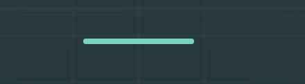
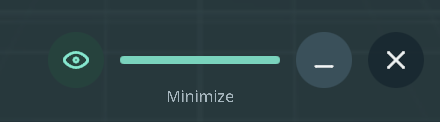

# Immersive window interactions

The immersive host supports a fixed minimal bar, controller/hand grabs anywhere on the window and edge resizing. Native 2D windows continue to use Horizon OS window management.

## Controls

The dock shows a short bar below the window. Its size, position and opacity remain unchanged on hover. Enter the fixed hover zone to reveal Placement on its left and Minimize/Close on its right. There is no expanding background and no move button in the dock. The side icons remain visible briefly after the pointer leaves, so they can be reached without a precise continuous hover. Pointer capture keeps them visible during a drag. Hidden buttons have no active hit regions. Reduced motion disables the icon fade.

Settings → Placement → Reveal window icons on hover selects hover-only or always-visible side icons. The preference is saved. The same bar remains available after minimizing or closing content; hover to reveal Restore/Open on its right.

Collapsed and revealed native Vulkan previews:

With a controller:

- Aim at the window and press/hold the grip button to move it.
- Aim near an edge or corner and hold grip to resize, if the application allows resizing. The highlighted edge shows the target.
- While holding, push the thumbstick up to move farther away and down to move closer.
- Move the thumbstick left/right to rotate the panel around its own vertical axis.
- Release grip to place the window. A held trigger is suppressed until release, preventing an accidental click after placement.
- The title and bar drag handles also work with the trigger.

With tracked hands, point at any part of the window and close the hand to grab it; open the hand to release. Grabbing an enabled edge/corner resizes it. Four-finger closure is measured from tracked joints, independently of the selected hand model. While closed, the last open-hand aim is carried with the wrist so finger occlusion does not immediately drop the grab. Missing wrist tracking or a system gesture cancels it. Index/thumb selection pinches and pinch-and-drag on the title/bar handles remain available.

Only one pointer owns a manipulation at a time. Grip has press/release hysteresis. Tracking or focus loss ends the gesture, and the button must be released before another grip can begin.

## Orientation and geometry

New preferences use FaceViewer. Existing saved placement-mode choices are respected. Movement faces the viewer by default, without copying head roll. FollowView remains a separate option that follows head position; manually placing a followed window switches it to FaceViewer at the chosen world position.

Manual thumbstick yaw is kept as an offset from viewer-facing orientation. Recenter resets that offset. Rotation can turn the panel away from the viewer; use the controller's recenter action if the front becomes inaccessible.

Resizing preserves the logical canvas aspect ratio, so the existing shared interface does not stretch. The opposite edge/corner remains fixed. Distance and yaw adjustments also work during a resize; the resize reference is rebased when they change.

Placement, physical size and manual yaw are session state. Recenter, changing the comfort placement controls or restarting the immersive activity restores the configured placement. The minimal-dock preference and selected follow mode are persisted.

## Application configuration

Configure the shared UiModel in AndroidAppConfig::configure:

    config.configure =  {
        ui.window.movable = true;
        ui.window.resizable = true;   // Set false for a fixed-size interface.
        ui.window.faceViewerWhileMoving = true;
        ui.window.minWidth = 0.45f;   // Metres.
        ui.window.maxWidth = 3.0f;
        ui.window.minDistance = 0.65f;
        ui.window.maxDistance = 4.0f;
    };

Set both movable and resizable to false to reserve the grip gesture for application content. These flags govern immersive panels; an Android 2D activity's resize policy still belongs to its manifest/system window configuration.

Additional options are edgePixels (logical pixels), moveSpeed (metres/second), turnSpeed (radians/second) and stickDeadZone. Defaults are 28, 1.3, 1.6 and 0.18. Unsupported/non-finite numeric limits receive bounded fallbacks.

An application can supply its own dock through renderApplicationDock. Its layout and hit regions are preserved. Hidden cinema UI and compact application-controlled interfaces do not receive stock window grips.

Window gestures take priority over content controls on the managed panel. While a gesture owns a controller, applicationInput receives an invalid/neutral sample to cancel content input; legacy controller/ray hooks receive their equivalent cancellation. Normal application samples resume after placement. Trigger and window ownership remain separate.

## Implementation and validation

The portable WindowMotion helper owns the geometry, edge tests, gesture ownership, distance limits and yaw offset. The OpenXR host intersects the entire physical window before widget/content dispatch, independently of captured widgets. It samples grip/thumbstick actions whether or not an application installs input hooks. HandGrabRay carries a valid aim relative to a tracked wrist during a closed-hand grab. Manipulation updates the quad pose and accessory placement; it does not add a render pass or rebuild UI geometry every frame.

Tests cover full-surface movement, grip hysteresis, no jump at initial capture, edge/corner resizing, opposite-anchor stability, aspect/size limits, stick distance and rotation, rebase during resize, tracking loss/rearm, two-controller ownership, trigger-handle compatibility, four-finger closure, open-hand aim retention/cancellation, fixed bar geometry/opacity, side-icon placement, zone reveal/collapse, hidden-button hit regions and the actual hover-preference control.

Automated geometry and rendering checks do not replace in-headset evaluation. Controller feel, hand/controller transitions, visual edge targeting and ergonomics across Quest models still require device testing.
